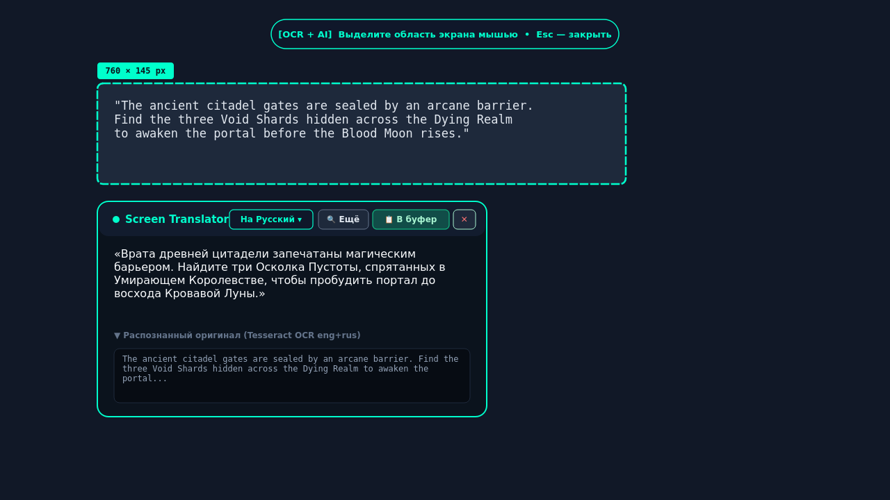

<div align="center">

🌐 **Language:** **English** | [Русский (README_Ru.md)](README_Ru.md)

# 🌐 Screen Overlay Translator (`S.O.T`)

**Ultra-fast screen OCR translator rendered directly over games, manga, videos, and desktop apps — built with Rust, Tauri v2, and Tesseract OCR**

[](https://www.rust-lang.org/)
[](https://v2.tauri.app/)
[](https://github.com/tesseract-ocr/tesseract)
[](https://github.com/Goblin-Inc/screen-overlay-translator/releases)

<br/>



</div>

---

## 📖 Overview

**Screen Overlay Translator (S.O.T)** is a native desktop application built with **Rust + Tauri v2** that lets you select any screen region in one click (untranslated game dialogue boxes, manga pages, PDF documents, terminal output, or video subtitles), instantly recognize the text via OCR, and display the translation in a translucent floating HUD overlay right next to the selected area.

### ✨ Key Features
- **Native Speed & Tiny Footprint**: the compiled Rust binary weighs only **~13 MB** and uses near-zero RAM while idle.
- **Smart Screen Capture & OCR Preprocessing Pipeline**:
  - Automatically picks the best screen capture tool for your environment: `maim` / `import` (X11), `spectacle` (KDE Plasma), `grim` (Wayland), or `scrot`.
  - Before passing the image to **Tesseract OCR** (`eng+rus+jpn+chi_sim`), the captured region undergoes **200% Lanczos3 upscaling**, grayscale conversion, and +35% contrast boosting — dramatically improving recognition accuracy on small pixel/game fonts.
- **Fault-Tolerant 4-Stage Translation Cascade**:
  1. **Stage 1**: `Google Dict Chrome Extension API` (`clients5.google.com`) — instant translation with automatic language detection.
  2. **Stage 2**: `Google GTX Endpoint` (`translate.googleapis.com`) with desktop `User-Agent`.
  3. **Stage 3**: `MyMemory Translation API` — fallback REST gateway.
  4. **Stage 4**: `Pollinations OpenAI-compatible LLM` — context-aware neural translation when traditional dictionaries are unreachable.
- **Adaptive Floating HUD**:
  - Compact overlay card (`440×210 px`) automatically positions itself near the selected region and can be dragged freely by its header.
  - On-the-fly target language switching (`To Russian`, `To English`, `To Japanese`, `To German`) with instant re-translation without taking a new screenshot.

---

## 🎮 How to Use

1. Launch **Screen Overlay Translator** (a compact floating card appears, or summon it via `Ctrl+Shift+T`).
2. Click **Select Region** (`🔍 More`), hold the left mouse button, and drag a selection box around any text on screen.
3. Within **~0.4–0.8 seconds**, the translated text appears in the HUD card, with the raw recognized text available under the **▸ Original OCR** spoiler.
4. Click **📋 Copy** to copy the translation to the clipboard, or drag the HUD card anywhere on screen.

---

## 🏗️ Project Architecture

```
screen-overlay-translator/
├── src/                        # Frontend (Vanilla ES6 + Glassmorphism CSS)
│   ├── index.html              # Floating HUD overlay markup and selection canvas
│   ├── main.js                 # Selection box logic, smart window positioning, and language switching
│   └── styles/overlay.css      # Translucent card styling and dark language selector
├── src-tauri/                  # Backend (Rust / Tauri v2)
│   ├── src/
│   │   ├── main.rs             # Window initialization, global Ctrl+Shift+T hotkey, and IPC commands
│   │   ├── capture.rs          # Screen capture (maim/spectacle/grim/import), crop, and 2x contrast upscale
│   │   ├── ocr.rs              # Tesseract OCR (--psm 6) integration and noise filtering
│   │   └── ai_client.rs        # 4-tier cascading translation engine with proxy/local LLM support
│   └── Cargo.toml
└── bin/
    └── screen-overlay-translator # Precompiled release binary (x86_64 Linux)
```

---

## 📦 Installation & Usage

### Option 1: Install from `.deb` package (Ubuntu / Debian / KDE Neon)
Go to [**Releases**](https://github.com/Goblin-Inc/screen-overlay-translator/releases) and download `screen-overlay-translator_1.0.0_amd64.deb`:

```bash
sudo dpkg -i screen-overlay-translator_1.0.0_amd64.deb
sudo apt-get install -f
```
The package automatically pulls in `tesseract-ocr`, `tesseract-ocr-eng`, `tesseract-ocr-rus`, and `maim`, adds a desktop entry, and installs the `screen-overlay-translator` command.

### Option 2: Arch Linux / Hyprland / Wayland (`install.sh` & `run.sh`)
```bash
git clone https://github.com/Goblin-Inc/screen-overlay-translator.git
cd screen-overlay-translator

# Automatically installs pacman dependencies (tesseract, grim, maim, webkit2gtk-4.1) and builds the release binary:
./install.sh

# Launch the overlay (automatically sets Wayland/Hyprland WebKitGTK environment variables):
./run.sh
```

### Option 3: Build from Source
```bash
sudo apt install tesseract-ocr tesseract-ocr-eng tesseract-ocr-rus maim libwebkit2gtk-4.1-dev
git clone https://github.com/Goblin-Inc/screen-overlay-translator.git
cd screen-overlay-translator/src-tauri
cargo build --release
```

---

## 📋 Changelog

### `v1.0.0` — Stable Release with 4-Stage Translator Cascade & Compact HUD *(Current)*
- **Added**: 4-tier fault-tolerant translation cascade in `ai_client.rs` (`clients5` -> `GTX` -> `MyMemory` -> `Pollinations AI`).
- **Added**: 200% Lanczos3 upscaling and contrast enhancement prior to OCR in `capture.rs`.
- **Improved**: Compact draggable overlay UI with dark language dropdown and collapsible original OCR text spoiler.
- **Added**: Release `.deb` installer and standalone binary in GitHub Releases.

---

<div align="center">
Developed by <a href="https://github.com/Goblin-Inc">@Goblin-Inc</a> • <a href="README_Ru.md">Русская версия</a>
</div>

## 📄 License
MIT © [Goblin-Inc](https://github.com/Goblin-Inc)
