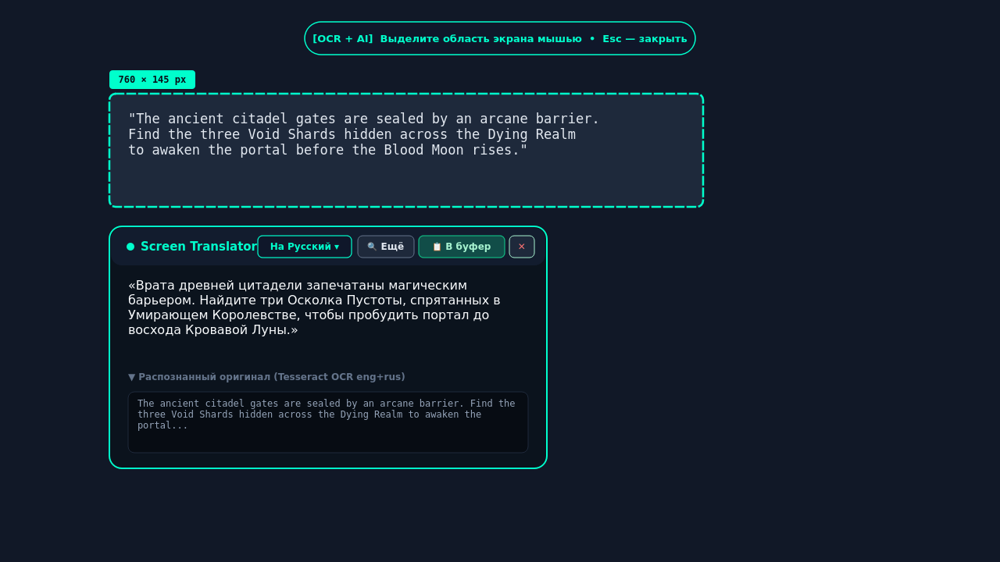

<div align="center">

🌐 **Язык:** [English (README.md)](README.md) | **Русский**

# 🌐 Screen Overlay Translator (`S.O.T`)

**Сверхбыстрый экранный OCR-переводчик поверх игр, манги, видео и любых приложений на базе Rust, Tauri v2 и Tesseract OCR**

[](https://www.rust-lang.org/)
[](https://v2.tauri.app/)
[](https://github.com/tesseract-ocr/tesseract)
[](https://github.com/Goblin-Inc/screen-overlay-translator/releases)

<br/>



</div>

---

## 📖 О проекте

**Screen Overlay Translator (S.O.T)** — нативное десктопное приложение на **Rust + Tauri v2**, позволяющее в один клик выделить любую область экрана (диалоговое окно в игре без русификатора, страницу манги, PDF-документ, терминал или субтитры в плеере), мгновенно распознать текст и вывести перевод в полупрозрачном плавающем HUD-оверлее прямо рядом с выделенным фрагментом.

### ✨ Ключевые возможности
- **Нативная скорость и минимальный вес**: скомпилированный бинарник на Rust весит всего **~13 МБ** и не расходует оперативную память в фоне.
- **Умный конвейер захвата и препроцессинга для OCR**:
  - Автоматический выбор инструмента захвата экрана под вашу среду: `maim` / `import` (X11), `spectacle` (KDE Plasma), `grim` (Wayland) или `scrot`.
  - Перед отправкой в **Tesseract OCR** (`eng+rus+jpn+chi_sim`) захваченный фрагмент автоматически проходит **200% Lanczos3 апскейл**, перевод в градации серого и усиление контраста (+35%), что кратно повышает точность распознавания мелких игровых шрифтов.
- **Отказоустойчивый 4-каскадный движок перевода**:
  1. **Канал 1**: `Google Dict Chrome Extension API` (`clients5.google.com`) — мгновенный перевод с определением языка.
  2. **Канал 2**: `Google GTX Endpoint` (`translate.googleapis.com`) с десктопным `User-Agent`.
  3. **Канал 3**: `MyMemory Translation API` — резервный REST-шлюз.
  4. **Канал 4**: `Pollinations OpenAI-compatible LLM` — контекстный нейросетевой перевод на случай недоступности классических словарей.
- **Адаптивный плавающий HUD**:
  - Компактная карточка (`440×210 px`) автоматически позиционируется возле выделенной области и свободно перетаскивается мышью за шапку.
  - Переключение целевого языка на лету (`На Русский`, `To English`, `На Японский`, `На Немецкий`) с мгновенным повторным переводом без нового скриншота.

---

## 🎮 Как пользоваться

1. Запустите **Screen Overlay Translator** (появится компактная плавающая карточка или вызов по глобальному хоткею `Ctrl+Shift+T`).
2. Нажмите **«Выделить область»** (`🔍 Ещё`), зажмите левую кнопку мыши и обведите рамкой текст на экране.
3. Через **~0.4–0.8 секунды** в карточке появится готовый перевод, а под спойлером **«▸ Распознанный оригинал (OCR)»** — исходный текст.
4. Нажмите **«📋 В буфер»**, чтобы скопировать перевод, или перетащите карточку в удобное место экрана.

---

## 🏗️ Архитектура проекта

```
screen-overlay-translator/
├── src/                        # Frontend (Vanilla ES6 + Glassmorphism CSS)
│   ├── index.html              # Разметка плавающего HUD-оверлея и холста выделения
│   ├── main.js                 # Логика выделения рамки, авто-позиционирования окна и смены языка
│   └── styles/overlay.css      # Стилизация полупрозрачной карточки и тёмного селектора языков
├── src-tauri/                  # Backend (Rust / Tauri v2)
│   ├── src/
│   │   ├── main.rs             # Инициализация окна, глобального хоткея Ctrl+Shift+T и IPC-команд
│   │   ├── capture.rs          # Захват экрана (maim/spectacle/grim/import), кроп и 2x контрастный апскейл
│   │   ├── ocr.rs              # Интеграция с Tesseract OCR (--psm 6) и фильтрация шума
│   │   └── ai_client.rs        # 4-уровневый каскадный переводчик с поддержкой прокси/локальной LLM
│   └── Cargo.toml
└── bin/
    └── screen-overlay-translator # Скомпилированный релизный бинарник (x86_64 Linux)
```

---

## 📦 Установка и запуск

### Вариант 1: Установка из `.deb` пакета (Ubuntu / Debian / KDE Neon)
Перейдите в раздел [**Releases**](https://github.com/Goblin-Inc/screen-overlay-translator/releases) и скачайте `screen-overlay-translator_1.0.0_amd64.deb`:

```bash
sudo dpkg -i screen-overlay-translator_1.0.0_amd64.deb
sudo apt-get install -f
```
Пакет автоматически подтянет `tesseract-ocr`, `tesseract-ocr-eng`, `tesseract-ocr-rus` и `maim`, добавит иконку в меню приложений и команду `screen-overlay-translator`.

### Вариант 2: Arch Linux (`pacman`) + готовый бинарник
```bash
# Установите системные зависимости OCR и захвата экрана на Arch Linux:
sudo pacman -S tesseract tesseract-data-eng tesseract-data-rus maim webkit2gtk-4.1

# Запустите готовый бинарник из папки bin/ или из Releases:
chmod +x ./bin/screen-overlay-translator
./bin/screen-overlay-translator
```

### Вариант 3: Сборка из исходников
```bash
sudo apt install tesseract-ocr tesseract-ocr-eng tesseract-ocr-rus maim libwebkit2gtk-4.1-dev
git clone https://github.com/Goblin-Inc/screen-overlay-translator.git
cd screen-overlay-translator/src-tauri
cargo build --release
```

---

## 📋 Changelog

### `v1.0.0` — Стабильный релиз с 4-каскадным переводчиком и компактным HUD *(Текущая версия)*
- **Добавлено**: 4-уровневый отказоустойчивый каскад перевода в `ai_client.rs` (`clients5` -> `GTX` -> `MyMemory` -> `Pollinations AI`).
- **Добавлено**: 200% Lanczos3 апскейл и повышение контрастности перед распознаванием в `capture.rs`.
- **Улучшено**: Компактный перетаскиваемый интерфейс оверлея с тёмным выпадающим списком языков и спойлером исходного OCR-текста.
- **Добавлено**: Релизный `.deb` инсталлятор и standalone-бинарник в GitHub Releases.

---

<div align="center">
Разработано <a href="https://github.com/Goblin-Inc">@Goblin-Inc</a>
</div>
